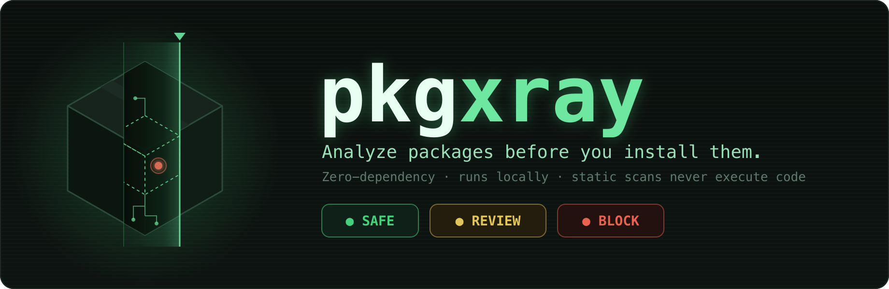

<div align="center">



# pkgxray — pre-install security for npm packages, MCP servers, and AI agents

Inspect an npm package or MCP server **before** you install it or connect to it.
You get a `SAFE`, `REVIEW`, or `BLOCK` verdict, decided by fixed rules and backed
by cited evidence. The analysis is static and runs on your machine without
installing npm dependencies. A pinned MIT-licensed Acorn parser is bundled.
Normal scans never execute package code; the opt-in canary is a separate,
fail-closed execution surface with mandatory OS confinement.

[](https://www.npmjs.com/package/pkgxray)
[](https://www.npmjs.com/package/pkgxray)
[](https://github.com/adamsjack711-ux/pkgxray/actions/workflows/pkgxray-test.yml)
[](https://github.com/adamsjack711-ux/pkgxray/actions/workflows/pkgxray-benchmark.yml)
[](LICENSE)

[**Website**](https://pkgxray.ca) · [**Documentation**](docs/README.md) · [**Calibration**](https://pkgxray.ca/stats) · [**Report a bug**](https://github.com/adamsjack711-ux/pkgxray/issues)


<sub>Real runs: <code>guard</code> clears <code>express@4.21.0</code>, then blocks a sample modeled on the 2024 <code>@solana/web3.js</code> compromise.</sub>

</div>

## Highlights

- **No npm dependency installation** — local Node analysis with a bundled, pinned JavaScript parser.
- **Install approved bytes** — [`pkgxray install`](docs/enforced-install.md) scans the npm lockfile, installs held archives offline with scripts disabled, and verifies the resulting files.
- **Normal scans never execute package code** — the tarball is read as bytes in quarantine.
- **Cited verdicts from fixed rules** — every finding names the file and the evidence. No model decides the verdict, so text planted in a package cannot steer it.
- **Artifact-bound enforcement** — approvals bind archive SHA-256, package identity, scanner build, policy and completed checks. Legacy or incomplete receipts cannot release bytes.
- **Cryptographic npm provenance** — when the trusted Node/npm runtime supplies Sigstore, pkgxray verifies the signature, transparency material, workflow identity and artifact subject. Set `PKGXRAY_REQUIRE_PROVENANCE=1` to make that mandatory.
- **Fail-closed execution boundaries** — canary and sandboxed MCP launches refuse to run when their requested OS confinement is unavailable.
- **Bounded services** — downloads, redirects, queues, subprocesses, frames, output and retained state have explicit limits; overload denies work rather than authorizing it.
- **Built for the agent era** — check MCP servers before you connect, gate the installs an agent runs, and re-audit live MCP traffic.
- **Adversarial gaps tracked openly** — [200 additional synthetic cases](benchmark/adversarial/README.md) and a [bounded third-party corpus](benchmark/external-results.json) track detections, holds and benign review burden without presenting internal tests as independent accuracy evidence.
- **Regression gates** — calibration and adversarial corpora run in CI; historical top-1000 results remain available for comparison.

> **[1. Quick start](#quick-start)** · [2. What it scans & detects](#what-it-scans--detects) · [3. Verdicts](#verdicts) · [4. Usage](#usage) · [5. Integrations](#integrations) · [6. How it compares](#how-it-compares) · [7. Documentation](#documentation)

## Why

AI coding assistants install packages and connect to MCP servers quickly, and
often no person reads the code first. Sonatype counted **more than 454,600 new
malicious open-source packages across monitored ecosystems in 2025**, over 99% of
them on npm
([Sonatype](https://www.sonatype.com/state-of-the-software-supply-chain/2026/open-source-malware)).
`npm audit` asks whether a package has a known CVE. pkgxray also asks what the
code does, before anything installs.

## Quick start

**1. Scan a known-benign package** (no install of pkgxray needed):

```bash
npx --yes pkgxray@1.2.0 guard npm:express@4.21.0
```

It stages the tarball in quarantine and runs the static and supply-chain checks.
There is no `npm install`, no lifecycle script, and no package code executed.

<details>
<summary>Sample output</summary>

```text
Decision: SAFE   Grade: A+ (99/100)
No high- or medium-risk indicators were found in the provided evidence.

Notes:
- INFO npm-vs-github-clean — npm tarball matches the linked GitHub repo at the
  published version. (15/16 files match GitHub @4.21.0)
```

</details>

**2. Read the verdict:**

| Verdict | Exit | Meaning |
|---|---:|---|
| `SAFE` | `0` | No high- or medium-risk indicators; default policy permits promotion. |
| `REVIEW` | `3` | Evidence is incomplete or a privileged capability needs human review. |
| `BLOCK` | `2` | High-severity cited evidence — reject or investigate. |

`SAFE` is not a proof that a package is harmless; static analysis cannot see a
payload downloaded only at runtime. See the [threat model](docs/threat-model.md).

**3. See a BLOCK on the supplied inert fixture:**

```bash
npx --yes pkgxray@1.2.0 --file examples/onboarding-malicious.json --format markdown
```

The fixture is inert source text that models a split-string SSH-key read and
exfiltration. **It is never executed.** It returns `BLOCK` (exit `2`) with the
cited file and evidence.

**4. Add it to your workflow** — [rechecks & CI](docs/reference.md#monitoring-pkgxray-recheck),
[MCP](docs/mcp.md#the-pkgxray-mcp-server), [Hookshot install gate](examples/hookshot/).

> **Two execution models.** Default `guard` and `audit` scans are **static**, so
> package code is never executed. Three surfaces are different: listing an MCP
> server's tools may spawn it, `mcp-proxy` runs it behind a gate, and the opt-in
> [`canary`](docs/canary-threat-model.md) *executes* the package in a sandbox to
> confirm what it does. The canary can confirm that a package is malicious, but it
> can never prove one is safe. Full boundary: [SECURITY.md](SECURITY.md#scope).

## What it scans & detects

**Scans** — `pkgxray guard npm:name@version` or `pypi:name@version`,
`github:owner/repo`, a local directory, whole lockfiles across two ecosystems
(npm: `package-lock.json`, `yarn.lock`, `pnpm-lock.yaml`, `package.json`; PyPI:
`requirements.txt`, `poetry.lock`, `Pipfile.lock`, `pyproject.toml`), MCP
servers, and AI-agent extensions.

**Detects** — credential theft (incl. split-fragment paths), cloud
instance-metadata and secret-store harvesting, prompt injection, Unicode
smuggling, base64 payloads and stage-2 loaders, exfiltration, persistence
(shell profile, OS scheduler, and injected CI/CD workflows), self-deleting
droppers, registry worm replication (install-time `npm publish`), npm
install-hook and PyPI `setup.py` install-time execution, obfuscated computed-arg
execution, hallucinated / slopsquat names (a lockfile pin the registry never
published), known CVEs (via OSV, before download), npm↔GitHub artifact
divergence, trojaned updates (`recheck`), and MCP
capability-surface abuse.

The full coverage matrix is in the [threat model](docs/threat-model.md), along
with the known blind spot: a package that downloads its payload later. A
side-by-side comparison table is on the [website](https://pkgxray.ca/#catches).

### Security pipeline

The layers are complementary. A positive trust signal never cancels suspicious
behavior found in the shipped bytes.

| Layer | What is enforced | Boundary |
|---|---|---|
| Acquisition | HTTPS/origin and connection-address policy, redirect checks, byte/time limits, archive identity and safe extraction | A registry or repository lookup can fail; fail-closed policy keeps the result at REVIEW/BLOCK. |
| Static analysis | Bounded parser, flow and lexical checks over inventoried runtime/source files | Dynamic resolution, native binaries and later runtime downloads are not exhaustively modeled. |
| Provenance | SLSA subject name/version/digests bound to the held archive; optional Sigstore certificate, CT, Rekor and workflow verification | Authenticated origin is not proof that the resulting code is harmless. |
| Approval | Version-2 receipts bind exact bytes, identity, scanner build, policy, coverage and completed checks | A receipt is a local trusted-process record, not a portable signature. |
| Installation/proxy | Offline script-disabled lockfile installation, installed-file verification, or pull-through release of the exact approved snapshot | Direct registries, existing caches and other package managers require separate routing controls. |
| MCP | Package-scan-first connect checks, manifest pins, bounded state, per-call verdicts, relist holds and model-visible result screening | Cross-call dataflow, unchanged-manifest implementation changes and opaque binary content remain outside complete coverage. |
| Canary | Install and first-import behavior under mandatory filesystem/network confinement, decoys, egress capture and resource limits | Positive evidence can confirm malice; a quiet run can never clear a package. |

## Verdicts

| Verdict | You should |
|---|---|
| `SAFE` | No blocking findings within the reported checks. Review coverage before installing. |
| `REVIEW` | Inspect the quarantined copy before promoting. |
| `BLOCK` | Do not install. Every finding names the file and evidence. |

Exit codes are stable and CI-friendly: **`0`** safe/allow · **`2`** block ·
**`3`** review.

## Usage

```bash
pkgxray guard npm:some-package@1.2.3 [--format json]   # vet a package before install
pkgxray guard pypi:some-package@1.2.3                  # same, for a PyPI package (sdist staged + scanned)
pkgxray guard npm:some-package@1.2.3 --archive ./package.tgz --integrity 'sha512-…' # scan exact held bytes
PKGXRAY_REQUIRE_PROVENANCE=1 pkgxray guard npm:some-package@1.2.3 # require verified npm provenance
pkgxray install package-lock.json                      # offline, scripts disabled, installed bytes verified
pkgxray mcp --package npm:some-mcp-server@1.4.2 npx some-mcp-server   # vet an MCP server; --recheck catches the rug-pull
pkgxray audit package-lock.json [--deep-all]               # also: yarn.lock, pnpm-lock.yaml, package.json
pkgxray audit requirements.txt [--deep]                # PyPI: also poetry.lock, Pipfile.lock, pyproject.toml
pkgxray recheck package-lock.json                      # scheduled: non-zero only on a regression
pkgxray canary npm:some-package@1.2.3 --yes-run-untrusted-code # disposable host only
```

`audit` checks resolved dependencies against OSV. `--deep` adds source scans for
blocked dependencies; `--deep-all` requests source scans for all resolved dependencies.
Failed deep scans and incomplete source collection return REVIEW unless already BLOCK.
`guard --deps` includes direct-dependency findings in its decision; only exact pins
are checked, with ranges and other unresolved sources left at REVIEW. Guard output
lists completed, partial, disabled and failed checks so a passing verdict does not
imply checks that never ran.
PyPI scans cover source-distribution manifests, vulnerability metadata, and text-level
injection checks; they do not provide full Python module behavioral analysis or wheel inspection.
Python source adds an `unsupported-behavior` REVIEW finding. Behavioral coverage gaps
cannot be muted or promoted with `allow-review`; a pinned artifact approval remains
an explicit operator override. Archives containing links or special files are rejected.

One optional `.pkgxray.json` tunes policy on the Node-based surfaces. The browser
extension scans supplied evidence using engine defaults and cannot read project configuration. No config
means the strictest settings. Config can never allow a CVE away, every loosening
is printed, and a scan that errors fails closed to `review`. Schema and rules:
[configuration.md](docs/configuration.md) · [`.pkgxray.example.json`](.pkgxray.example.json).

For npm provenance, pkgxray uses the maintained Sigstore SDK shipped beside the
trusted Node/npm runtime, never a dependency from the package being audited.
`PKGXRAY_REQUIRE_PROVENANCE=1` makes authenticated, artifact-bound provenance a
mandatory hold: missing/unavailable verification is REVIEW and invalid
provenance is BLOCK. A separately maintained absolute verifier path can be set
with `PKGXRAY_SIGSTORE_MODULE`; that path is trusted executable code.

## Integrations

One engine behind every entry point. "Works with" means a documented setup
guide, not a vendor-endorsed integration.

| Where | What it does | Guide |
|---|---|---|
| Coding agents — Codex, Claude Code, Cursor, Windsurf | Gate installs and expose the audit tools to the agent | [coding-agents.md](docs/integrations/coding-agents.md) |
| MCP clients | Vet a server before connect; run pkgxray itself as an MCP server | [mcp.md](docs/mcp.md) |
| GitHub Actions / CI | Fail a build when a dependency crosses policy | [github-actions.md](docs/integrations/github-actions.md) |
| Install gate — Hookshot | Run `guard` on every package an agent tries to install | [examples/hookshot/](examples/hookshot/) |
| Shared npm registry gate | Hold tarballs, share bounded scans, persist exact-byte approvals and denial-only holds | [pkgxray-proxy](examples/pkgxray-proxy/) |
| Runtime MCP gate | Proxy a live MCP server and gate every tool call | [`mcp-proxy`](docs/mcp.md#per-call-runtime-gate-pkgxray-mcp-proxy) |
| Dependency monitoring | Re-vet installed deps and pre-vet upgrades on a schedule | [`recheck`](docs/reference.md#monitoring-pkgxray-recheck) |

## Boundaries that still matter

- A clean tarball can fetch or activate its real payload later. Static analysis
  can flag the capability, but cannot observe every future behavior.
- Canary runs only lifecycle hooks and first import without installing package
  dependencies. Dormant, sandbox-aware, delayed and interaction-gated payloads
  may remain quiet; run it only on disposable infrastructure.
- MCP result screening is bounded and does not track information flow across
  multiple allowed calls. `mcp-proxy` wraps stdio children, not remote HTTP MCP
  servers, and does not interpret opaque binary media.
- Python receives manifest, install-hook, vulnerability and neutral text checks,
  but not complete module behavior analysis or wheel inspection.
- The third-party corpus is small and selection-biased. REVIEW means a strict
  deployment would hold the package; it is not the same as a confirmed BLOCK or
  a measured malware-detection rate.

See [threat-model.md](docs/threat-model.md),
[canary-threat-model.md](docs/canary-threat-model.md) and
[mcp.md](docs/mcp.md) for the complete boundaries.

## How it compares

`npm audit` and OSV-Scanner check for published CVEs, and pkgxray does not
replace them. Run it alongside them. The tools in the same lane are Socket.dev,
OpenSSF Package Analysis, and Cisco MCP Scanner, which also analyze what package
code does. The full capability comparison is in
[docs/comparison.md](docs/comparison.md) and on the
[website](https://pkgxray.ca/#comparison).

## Evidence

Historical top-1000 runs and their [scope and methodology](docs/benchmark.md)
remain available at [pkgxray.ca/stats](https://pkgxray.ca/stats). Those results
predate the parser-based flow engine and have not been rerun for this change.
The current engine passes all 272 internal frozen fixtures without a malicious
SAFE or benign BLOCK; many malicious cases produce REVIEW. The sets comprise 72
calibration cases, 180 adversarial challenge variants and 20 former-holdout
variants. This is regression evidence, not a real-world detection-rate estimate.

The pinned third-party static run adds eight labeled malicious archives and four
project-selected benign controls. Seven malicious samples were held at REVIEW,
one exceeded the fixed extraction bound, three benign controls were SAFE and one
was REVIEW; none were BLOCK. Those results demonstrate strict-policy holds and a
25% benign review rate in this tiny convenience sample—not population precision,
recall or independent certification. The hashes, selection rule and full result
are recorded in [benchmark/external-results.json](benchmark/external-results.json).

## Documentation

| Doc | What it covers |
|---|---|
| [architecture.md](docs/architecture.md) · [design.md](docs/design.md) | Pipeline, surfaces, principles |
| [threat-model.md](docs/threat-model.md) | Scope, blind spots, prompt-injection stance |
| [mcp.md](docs/mcp.md) · [mcp-registry.md](docs/mcp-registry.md) | MCP vetting, runtime proxy, registry entry |
| [canary-threat-model.md](docs/canary-threat-model.md) | The opt-in behavioral canary |
| [configuration.md](docs/configuration.md) · [reference.md](docs/reference.md) | `.pkgxray.json`, severity policy, `recheck`, cache server |
| [benchmark.md](docs/benchmark.md) · [comparison.md](docs/comparison.md) | Calibration and how it compares |
| [compatibility.md](docs/compatibility.md) · [json-schema.md](docs/json-schema.md) | 1.0 contract, `--format json` schema |

Start at the [documentation index](docs/README.md).

## Contributing

```bash
npm test                 # zero-dep node --test suite
npm run benchmark        # calibration corpus: precision/recall + 0-false-block gate
npm run benchmark:adversarial # frozen internal challenge diagnostics
npm run benchmark:holdout     # frozen former-holdout diagnostics
npm run validate:external     # bounded static third-party run; no package execution
npm run validate:website # regenerate + validate the calibration pages
```

`validate:external` deliberately exits non-zero while a selected archive cannot
be scanned within the fixed extraction bound. It never installs, imports or
submits corpus packages to canary, and removes private temporary payloads.

Pull requests are welcome. Read [CONTRIBUTING.md](CONTRIBUTING.md) and the
[Code of Conduct](CODE_OF_CONDUCT.md) first. Report vulnerabilities privately,
as [SECURITY.md](SECURITY.md) describes. Releases publish to npm with provenance
(SLSA attestation), and each one is gated on the tests, the calibration
benchmark, and pkgxray's own supply-chain guard.

<div align="center">
<sub>Built by <a href="https://github.com/adamsjack711-ux">Jack Adams-Lovell</a> · <a href="LICENSE">MIT</a> · <a href="https://pkgxray.ca">pkgxray.ca</a></sub>
</div>
