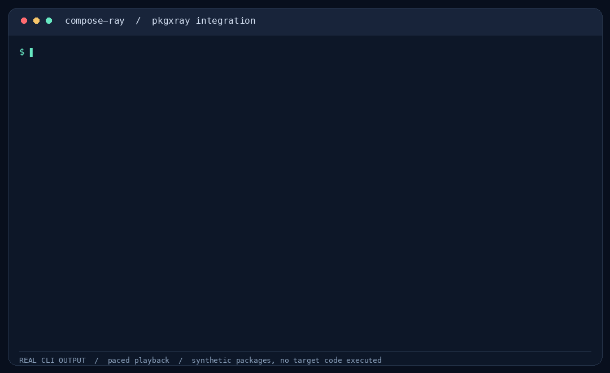

<div align="center">


**pkgxray checks the packages. Compose-ray follows the data between them.**

[](https://github.com/adamsjack711-ux/package-compose-ray/actions/workflows/test.yml)
[](LICENSE)
[](docs/roadmap.md)

</div>

A token can pass through a reader, a formatter, and a sender in three different
packages. **Compose-ray follows the connection**, showing which files and lines
carry the data to a network call.

## See it run



*Real output from synthetic packages. Target code is never executed.
[Still image](docs/assets/cli-demo.png) · [Run the demo](#try-it)*

## Try it

Node.js 22 or 24 recommended. No dependency install required.

```sh
git clone https://github.com/adamsjack711-ux/package-compose-ray.git
cd package-compose-ray
npm run demo:strings

# Run both engines using a trusted pkgxray checkout.
npm run demo:integration -- /path/to/pkgxray

# Scan your own local source snapshot.
node bin/compose-ray.mjs /path/to/project --entry index.js \
  --pkgxray /path/to/pkgxray --json
```

## Better together

| pkgxray | Compose-ray |
| --- | --- |
| Inspects packages for suspicious behavior | Traces data across package boundaries |
| Supplies package findings | Adds source → call → return → network evidence |
| Owns its full installation-policy workflow | Adds evidence without issuing approval |

**v0.3.1 prototype:** combined mode checks selected local files and preserves both
engines’ findings and gaps. It does not yet verify registry archives or authorize
installation. A detected transfer may be legitimate; no finding does not mean safe.

[Documentation](docs/README.md) · [Coverage](docs/reference.md) ·
[Integration](docs/integration.md) · [Roadmap](docs/roadmap.md) ·
[Contribute](CONTRIBUTING.md) · [Security](SECURITY.md)
