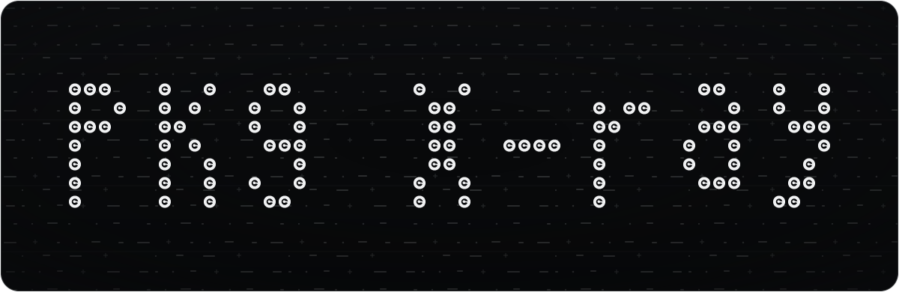

<p align="center"></p>

<p align="center"><sub>PRE-INSTALL PACKAGE SECURITY</sub></p>

<h1 align="center">Look inside. Then install.</h1>

<p align="center">
  Inspect npm packages and MCP servers before install or connection.<br>
  Local static analysis. A SAFE, REVIEW, or BLOCK verdict with cited evidence.
</p>

<p align="center">
  <a href="#first-scan">Run your first scan</a> ·
  <a href="docs/README.md">Read the docs</a>
</p>

## First scan

Node.js 18+ and network access; no global install.

```bash
npx --yes pkgxray@1.2.1 guard npm:express@4.21.0
```

## In a recorded scan

`pkgxray 1.2.1` · checked 2026-11-08 · exit 0

```text
Verdict: **SAFE**
Findings:
- **INFO - network-access** in `lib/request.js`: Performs outbound network activity.
```

Source and vulnerability checks completed; direct dependencies were not requested. `SAFE` means no blocking finding within the checks that completed—not proof of harmlessness.

## Limits

Static analysis cannot see runtime-fetched payloads. Listing MCP tools can start a server; the proxy runs it, and a scan does not control an agent’s later install.

## Public MCP

Connect to `https://mcp.pkgxray.ca/mcp` using **Streamable HTTP**, with no API key or install. [Setup](docs/mcp.md#the-pkgxray-mcp-server) · [Source and limits](services/public-mcp/README.md).
Checks supplied snippets and npm metadata/advisories on Cloudflare; no package execution, VM, complete archive scan, or installation approval. Do not submit secrets.

## Documentation

[Docs index](docs/README.md) · [Reference](docs/reference.md) · [Threat model](docs/threat-model.md) · [BLOCK example](docs/reference.md#synthetic-block-example) · [Security](SECURITY.md) · [Website](https://pkgxray.ca)
