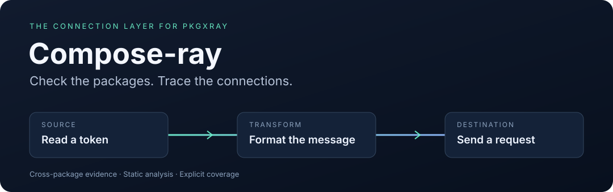

<div align="center">



# Compose-ray

**pkgxray checks the packages. Compose-ray follows the data between them.**

[](https://github.com/adamsjack711-ux/package-compose-ray/actions/workflows/test.yml)
[](LICENSE)
[](docs/roadmap.md)

[Try it](#try-it) · [How it fits](#how-it-fits-with-pkgxray) · [Documentation](docs/README.md) · [Roadmap](docs/roadmap.md) · [Contribute](CONTRIBUTING.md)

</div>

An app can use one package to read a token, another to format it, and a third
to send a request. Reviewing each package separately does not explain the whole
journey. **Compose-ray follows that journey and gives you a source-to-network
trail with package versions, files, and line numbers.**

It complements [pkgxray](https://github.com/adamsjack711-ux/pkgxray), which checks
packages for suspicious behavior and supply-chain risk. Together, they can put
package findings and cross-package connections into one review report.

> **Working prototype · v0.3.0.** The local integration runs real pkgxray static
> checks on selected source files. Verified registry acquisition and installation
> approval are future integration work. A clear flow result is not proof of safety.

## See the connection

```text
 demo-reader@1.0.0       demo-formatter@1.0.0       demo-sender@1.0.0
 ┌─────────────────┐    ┌────────────────────┐    ┌───────────────────┐
 │ Read NPM_TOKEN  │ ─► │ Format as JSON     │ ─► │ Send HTTP request │
 └─────────────────┘    └────────────────────┘    └───────────────────┘
          └──────────── Compose-ray follows the data ──────────┘

 REVIEW: environment data reaches a network call across package boundaries.
 Evidence: source → return → call → return → call → sink, with file locations.
```

The transfer may be intentional. The report gives you the route to investigate;
it does not label every token-bearing request as malware.

## Try it

Use Node.js 22 or 24 for the CI-tested setup. Node.js 18+ is supported by the
standalone scanner. No `npm install` is needed; the parser is bundled.

```sh
git clone https://github.com/adamsjack711-ux/package-compose-ray.git
cd package-compose-ray
npm test
npm run demo:strings
```

The offline demo checks credential formatting alongside harmless controls:

```text
review        Credential with prefix and suffix (1 finding(s), 0 gap(s))
review        Credential serialized then prefixed (1 finding(s), 0 gap(s))
review        Mixed template and concatenation (1 finding(s), 0 gap(s))
no-flow-found Harmless prefix and suffix (0 finding(s), 0 gap(s))
no-flow-found Harmless JSON formatting (0 finding(s), 0 gap(s))
incomplete    Unsupported custom serialization (0 finding(s), 2 gap(s))
```

### Run both engines

Point to a **trusted pkgxray checkout or unpacked distribution**, separate from
the source being scanned. This loads the scanner's code; target packages remain
inert source strings.

```sh
npm run demo:integration -- /path/to/pkgxray
```

The demo creates disposable synthetic packages, runs both real engines, prints
the credential trail, and checks three controls:

```text
COMPOSE-RAY + PKGXRAY
Check the packages. Trace the connections.

Decision: REVIEW | Coverage: partial | Execution: completed
...
Connections: review (1 flow(s))
  CROSS-PACKAGE environment data → network
...
CONTROL CASES
public       decision=review flow=no-flow-found coverage=partial
unsupported  decision=review flow=incomplete coverage=partial
blocked      decision=block flow=no-flow-found coverage=partial
```

The public-data control still needs review because the combined scan does not
inventory every file or verify registry artifacts. The blocked control shows
the other direction: pkgxray flags an uncalled private-key reader in a selected
file. **A clear Compose-ray result cannot erase pkgxray evidence.**
The demo exits `0` when its assertions pass; that is not a package approval.

### Scan your own snapshot

Supply an npm v2/v3 lockfile and matching local package sources. Compose-ray does
not download dependencies or run installation scripts.

```sh
# Trace connections from a CommonJS entry file.
node bin/compose-ray.mjs /path/to/project --entry index.js

# Add package checks and emit the complete combined evidence report.
node bin/compose-ray.mjs /path/to/project --entry index.js \
  --pkgxray /path/to/pkgxray --json > combined-report.json
```

| Mode | Results and exit codes |
| --- | --- |
| Flow only | `0` no modeled flow · `1` review finding · `2` incomplete or invalid usage |
| With pkgxray | `2` block or invalid usage · `3` review, including incomplete coverage |

Combined mode deliberately has no install-allow result. Use the JSON fields to
distinguish findings, execution failures, and coverage limits.

## How it fits with pkgxray

| Responsibility | pkgxray | Compose-ray |
| --- | --- | --- |
| Package inspection | Suspicious code, supply-chain evidence, vulnerability checks in its full workflow | Consumes package sources and locked identities |
| Flow analysis | Existing within-package analysis | Follows supported calls and values across dependencies |
| Review evidence | Package findings and severity | Source, call, return, and network locations |
| Install decisions | Owns acquisition, policy, and artifact approval in its full workflow | Adds evidence; never issues installation approval |

**Available today:** an offline adapter runs pkgxray's `auditEvidence` against
the manifests and sources selected by Compose-ray. File hashes are checked
between scans, nested package instances stay distinct, and both engines' original
results remain in the combined JSON. The adapter does not run pkgxray's full
`guard`, vulnerability lookup, provenance verification, or install workflow.

**Next:** consume pkgxray's verified package snapshots, inventory the intended
scan scope, and feed composition evidence into its policy without weakening
existing holds. See the [integration contract](docs/integration.md).

## What makes it useful

- **Follow the actual connection.** An unused sender or an unrelated public
  message does not become a credential-flow finding just because both exist.
- **Keep the right package instance.** Nested and hoisted versions resolve from
  the calling file, using the npm lockfile and source manifests.
- **Track ordinary formatting.** Concatenation, templates, supported primitive
  conversions, JSON formatting, and package returns retain source traces.
- **Explain the evidence.** Every route cites source files, locations, and package
  identities; JSON preserves findings and analysis gaps from both engines.
- **Keep uncertainty visible.** Unsupported semantics and exhausted budgets
  prevent a completed flow result. A package block always takes precedence.
- **Read target code without running it.** No target imports, lifecycle scripts,
  real environment-secret reads, or network requests are needed for these scans.

## Coverage, honestly

The scanner models a bounded CommonJS subset from one entrypoint. ESM, loops,
async behavior, regex execution, most callbacks, and many runtime APIs are not
modeled. Uncalled functions and other entrypoints are outside the flow scope.
Selected real-package paths work; broad npm compatibility has not been established.

`no-flow-found` means no modeled flow was found in the reported scope. It does
not mean an application is safe. The tests are regression evidence, not an
independent detection-rate benchmark.

[Full scanner reference](docs/reference.md) · [Threat model](SECURITY.md) ·
[Architecture](docs/architecture.md) · [Changelog](CHANGELOG.md)

## Build with us

The most useful contribution is a small example that exposes a missing flow,
paired with a harmless example that should stay clear. Start with
[CONTRIBUTING.md](CONTRIBUTING.md) and the [roadmap](docs/roadmap.md).

MIT licensed. Vendored Acorn and the pinned `ms` test fixture retain their own
license and provenance files. The repository is public; no npm release is
published by this project.
