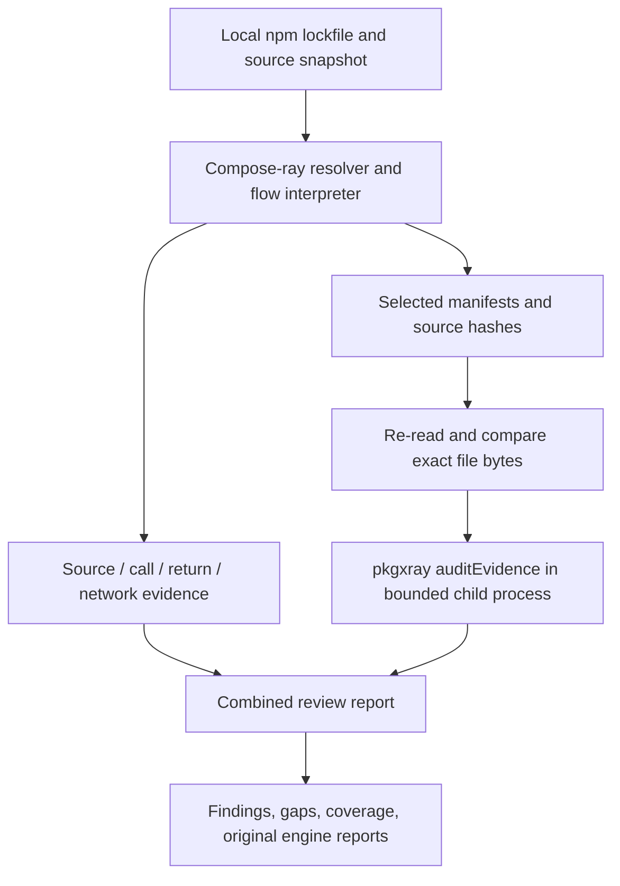
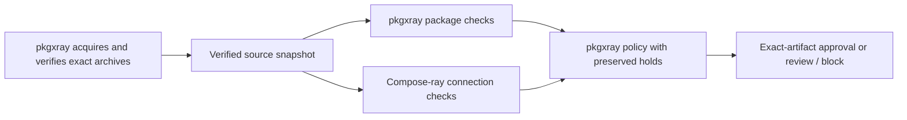

# Architecture

Compose-ray adds cross-package context to pkgxray's package evidence. The two
engines retain distinct responsibilities and report their own limits.

## Current local integration

1. `src/project.mjs` resolves locked package instances and reads bounded local
   files. Nested versions remain separate instances even when names match.
2. `src/analyze.mjs` parses with vendored Acorn and symbolically follows a bounded
   CommonJS entry path. It never loads target code through Node's module loader.
3. `src/integration.mjs` re-reads recorded files, checks hashes and the lockfile,
   and prepares evidence per package instance. Paths become relative to that
   instance for pkgxray's existing local analysis.
4. `src/pkgxray-worker.mjs` loads an explicitly trusted scanner and invokes
   `auditEvidence`. The worker has a deadline and bounded captured output. It is
   a failure boundary, not an OS sandbox for an untrusted scanner.
5. The adapter validates the response and retains both engines' reports. It
   reports `block` if pkgxray blocks any package, otherwise `review`. Neither
   state is an installation authorization.

The adapter does not alter pkgxray, copy its implementation, invoke its installer,
or fetch registry packages. No package code is executed in the demo.

## Intended verified-source integration

This second diagram is the planned workflow, not a shipped approval path. It
requires a versioned snapshot contract binding archive digests, installed paths,
file bytes, entrypoints, scanner builds, and completed checks. A clean composition
result must never erase a package block or incomplete mandatory check.

Package inspection can see suspicious code outside the selected flow path.
Connection analysis can establish a route between individually ordinary helpers.
The demo's blocked and credential controls exercise both directions. Combining
evidence does not justify combining coverage claims.
